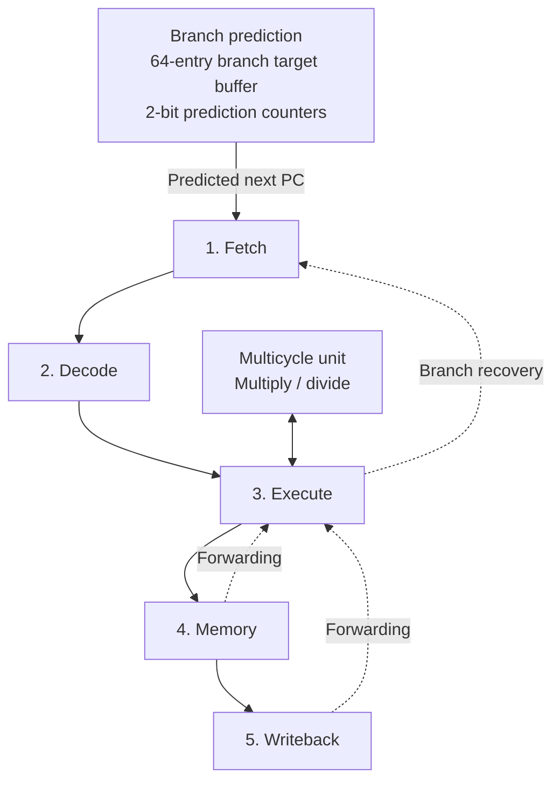

# FPGA-Based Pipelined RISC-V Processor

A five-stage, 32-bit RISC-V processor implemented in Verilog with VHDL board integration for an Artix-7 FPGA. Developed as a team project for NUS CG3207, extending the supplied processor framework from a single-cycle design to a pipelined implementation.

## Architecture



The five pipeline stages run from top to bottom. Dashed arrows show branch recovery and data forwarding paths.

- Five pipeline stages with data forwarding, load-use stalls, and wrong-path instruction flushing.
- Dynamic branch prediction using a 64-entry branch target buffer and 2-bit counters.
- Multicycle arithmetic, including Booth signed multiplication, upper-product and remainder operations.
- Byte, halfword, and word memory accesses, with byte write enables for partial stores.
- FPGA integration with switches, LEDs, seven-segment output, and UART benchmark reporting.

## Measured performance

Board measurements compare the **50 MHz pipelined processor with prediction** against the **25 MHz single-cycle baseline**. These are configured operating clocks, not measured maximum clock frequencies.

| Workload | Input | Single-cycle time | Pipelined + prediction time | Speedup |
| --- | --- | --- | --- | --- |
| Iterative Fibonacci | 39 | 27.76 µs | 16.40 µs | 1.69× |
| Recursive Fibonacci | 24 | 132.04 ms | 77.23 ms | 1.71× |
| Fibonacci table | 39 | 27.80 µs | 17.30 µs | 1.61× |
| Prime counting | 1008 | 17.58 ms | 9.32 ms | 1.89× |

At the **same 50 MHz clock**, enabling branch prediction reduced execution cycles by **4.0–12.8%** for these inputs. The benchmark uses unoptimised (`-O0`) C; results depend on the workload and predictor state. See [full measurements and methodology](Asst_04/Code/bench_results.md).

## Repository layout

| Path | Contents |
| --- | --- |
| `Asst_04/Src/` | Verilog CPU, VHDL integration/peripherals, and memory images |
| `Asst_04/Test_bench/` | CPU and component testbenches |
| `Asst_04/Code/` | C benchmark, assembly, and recorded measurements |
| `Asst_04/Constraint/` | Board-specific pin and clock constraints |
| `Asst_04/bitstream/TOP.bit` | Previously generated demonstration bitstream |
| `Asst_04/Enhancement.pptx` | Project presentation |
| `scripts/` | Simulation runner |


## Build and verification

See [FPGA setup and simulation](docs/BUILD.md) for source selection, board constraints, clock IP, and test commands. See the [assignment reference](Asst_04/README.md) for benchmark controls and clock configurations.

Run the automated Verilog checks from the repository root with Icarus Verilog installed:

```sh
bash scripts/run_tests.sh
```

See [CONTRIBUTING.md](CONTRIBUTING.md) for the development workflow.
